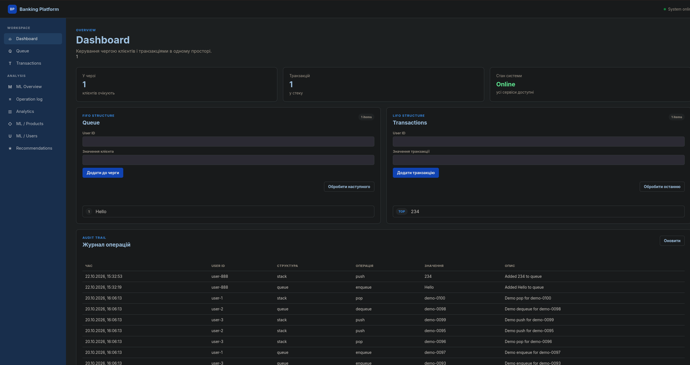
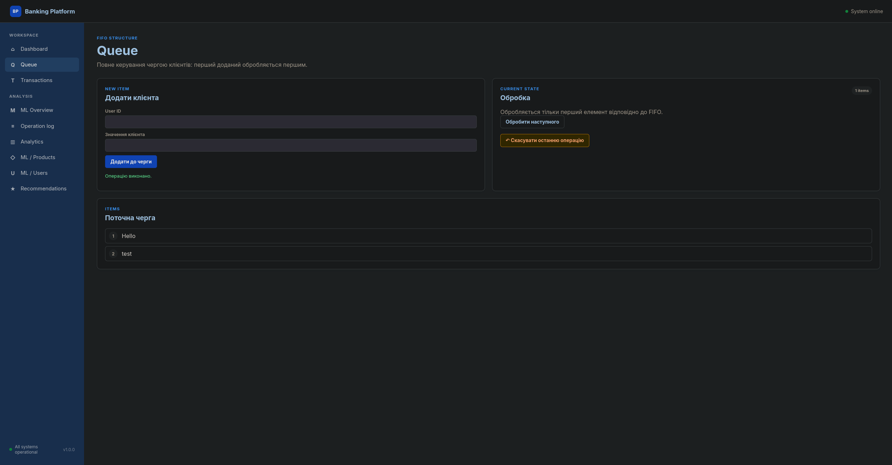
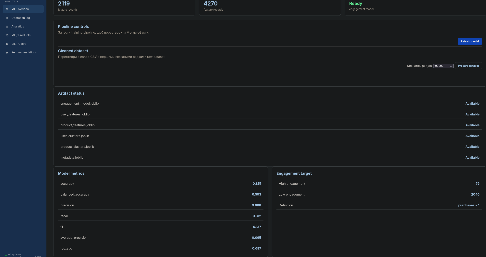
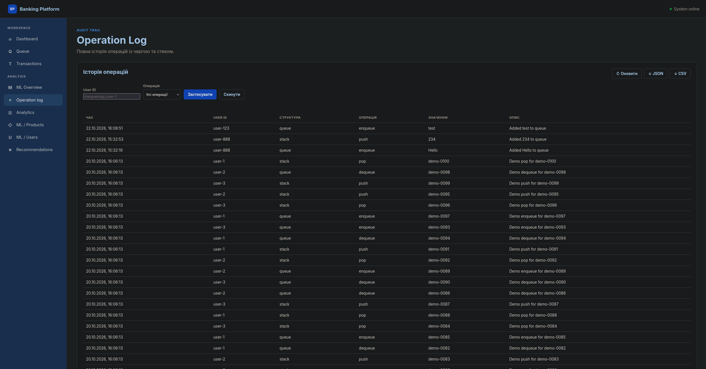
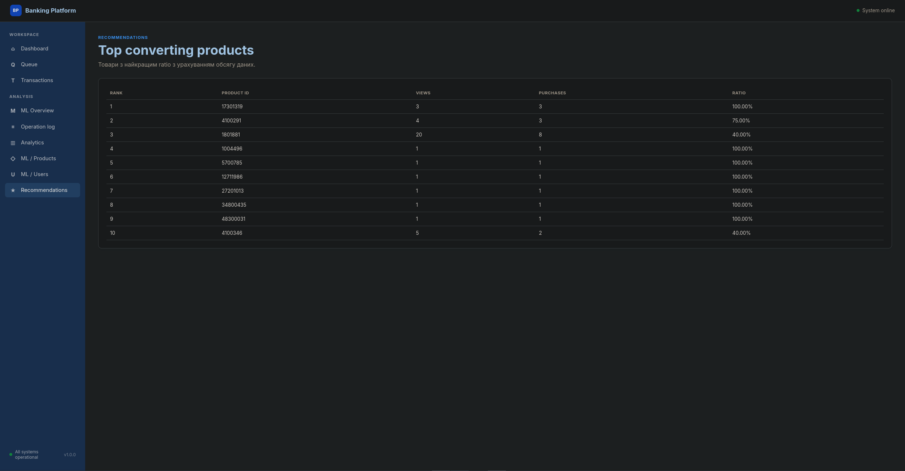

# Fullstack Data-Driven Banking Platform

Навчальна full-stack платформа на Flask, яка поєднує класичні структури даних,
SQLite, REST API, інтерактивний вебінтерфейс і невеликий ML-пайплайн.

За сюжетом це банківське відділення: клієнти потрапляють у FIFO-чергу,
операції проходять через LIFO-стек, кожна дія записується в журнал, а поведінка
користувачів і продуктів аналізується окремим data pipeline. Проєкт можна
запустити локально, перевірити тестами й використовувати як основу для
експериментів із даними, алгоритмами та Flask.

> Детальніше про джерело даних, структуру CSV та підготовку датасету дивіться
> у [документації до датасету](data/README.md).

## Навігація

- [Що вміє проєкт](#що-вміє-проєкт)
- [Технології](#технології)
- [Встановлення](#встановлення)
- [Дані для ML-пайплайна](#дані-для-ml-пайплайна)
- [Запуск застосунку](#запуск-застосунку)
- [ML pipeline](#ml-pipeline)
  - [Артефакти](#артефакти)
- [Практичні приклади](#практичні-приклади)
  - [Робота з чергою через API](#робота-з-чергою-через-api)
  - [Робота зі стеком транзакцій](#робота-зі-стеком-транзакцій)
  - [Undo](#undo)
  - [Фільтрація журналу](#фільтрація-журналу)
  - [Експорт](#експорт)
  - [Рекомендації](#рекомендації)
- [Структура проєкту](#структура-проєкту)
- [Архітектура та ключові механізми](#архітектура-та-ключові-механізми)
  - [Backend і база](#backend-і-база)
  - [Валідація](#валідація)
  - [UI](#ui)
  - [Розділення production і test database](#розділення-production-і-test-database)
- [Тестування та якість коду](#тестування-та-якість-коду)
- [Зіставлення з `project_plan.pdf`](#зіставлення-з-project_planpdf)
- [Додатковий функціонал (Custom Features)](#додатковий-функціонал-custom-features)
  - [Напрям B — Algorithms & CI: GitHub Actions CI](#напрям-b--algorithms--ci-github-actions-ci)
  - [Напрям C — Web & UX: Undo операцій](#напрям-c--web--ux-undo-операцій)
  - [Напрям C — Web & UX: експорт журналу](#напрям-c--web--ux-експорт-журналу)
  - [Напрям C — Web & UX: фільтри без перезавантаження](#напрям-c--web--ux-фільтри-без-перезавантаження)
  - [Pydantic-валідація API](#pydantic-валідація-api)
  - [Керування ML pipeline з вебінтерфейсу](#керування-ml-pipeline-з-вебінтерфейсу)
  - [Дозавантаження великих таблиць](#дозавантаження-великих-таблиць)
  - [Консервативне ранжування рекомендацій](#консервативне-ранжування-рекомендацій)
  - [Розширена оцінка ML-моделі](#розширена-оцінка-ml-моделі)
  - [Операційна аналітика та ML-сторінки](#операційна-аналітика-та-ml-сторінки)
  - [Одноразовий генератор demo-логів](#одноразовий-генератор-demo-логів)
- [Що можна розвивати далі](#що-можна-розвивати-далі)

## Що вміє проєкт

- керує чергою клієнтів через `enqueue()` / `dequeue()`;
- керує стеком транзакцій через `push()` / `pop()`;
- зберігає операції в SQLite через SQLAlchemy;
- показує живий стан структур і журналу через Fetch API без reload;
- підтримує undo останньої операції для конкретного користувача;
- фільтрує журнал за `user_id` і типом операції;
- експортує повний журнал у JSON і CSV;
- завантажує ML-дані, очищує їх і будує ознаки для користувачів та продуктів;
- кластеризує користувачів і продукти через KMeans;
- навчає Random Forest для оцінки залученості користувачів;
- показує ML-метрики, класи, features, кластери й рекомендації у вебінтерфейсі;
- ранжує рекомендації з урахуванням не лише ratio, а й обсягу даних;
- запускає тести для алгоритмів, структур, ML-модулів і Flask API.

<!-- Скріншот: головна сторінка або dashboard із чергою, стеком і навігацією. -->


## Технології

- **Python 3.14**
- **Flask 3**
- **Flask-SQLAlchemy** та **SQLite**
- **Jinja2**, HTML/CSS, vanilla JavaScript і Fetch API
- **Pydantic 2** для валідації request/query-параметрів
- **pandas** для обробки даних
- **scikit-learn**: `StandardScaler`, `KMeans`, `RandomForestClassifier`,
  `GridSearchCV`
- **joblib** для ML-артефактів
- **pytest** для тестів
- **ruff** і **pre-commit**
- **GitHub Actions** для CI

## Встановлення

Клонуйте репозиторій і перейдіть у його директорію:

```bash
git clone <https://github.com/HliebKurtushyn/UsersAnalysis.git>
cd UsersAnalysis
```

Створіть віртуальне середовище:

```bash
python3.14 -m venv .venv
source .venv/bin/activate
```

У Windows PowerShell активація виглядатиме так:

```powershell
.venv\Scripts\Activate.ps1
```

Встановіть залежності:

```bash
python -m pip install --upgrade pip
python -m pip install -r requirements.txt
```

## Дані для ML-пайплайна

Проєкт очікує файл `2019-Nov.csv` у директорії `data/raw/`. Він походить із
[Kaggle dataset E-commerce behavior data](https://www.kaggle.com/datasets/mkechinov/ecommerce-behavior-data-from-multi-category-store).

Потрібна структура:

```text
data/
└── raw/
    └── 2019-Nov.csv
```

CSV має містити щонайменше такі колонки:

```text
event_type, user_id, event_time, product_id,
category_code, brand, price
```

Сирі датасети навмисно не зберігаються в репозиторії. Після очищення можна
створити `data/cleaned/2019-Nov.csv`; він буде використаний наступними
запусками pipeline.

## Запуск застосунку

У режимі розробки:

```bash
python run.py
```

Після запуску відкрийте <http://127.0.0.1:5000>.

`run.py` запускає Flask із `debug=True`, тому цей спосіб підходить для локальної
розробки, а не для production. База створюється в `instance/banking.db`.
`db.create_all()` створює відсутні таблиці, але не очищає наявні записи.

<!-- Скріншот: сторінка Queue або Transactions із виконаною операцією та повідомленням про успіх. -->


## ML pipeline

Пайплайн складається з кількох незалежних кроків:

1. `data_loader.py` читає CSV, перевіряє обов’язкові колонки й за потреби
   обмежує кількість рядків через `nrows`.
2. `eda_and_cleaning.py` прибирає дублікати, нормалізує `event_time`, заповнює
   `brand` і `category_code` значенням `Unknown` та видаляє рядки без ключових
   полів.
3. `feature_engineering.py` агрегує події за `user_id` і `product_id`.
   Основні ознаки: `views`, `carts`, `purchases`.
4. `clustering.py` масштабує ознаки через `StandardScaler` і створює KMeans
   кластери користувачів та продуктів.
5. `modeling.py` навчає Random Forest. Ціль визначена як
   `purchases >= 1`, а для навчання використовуються тільки `views` і `carts`,
   щоб не передавати моделі саму ознаку, з якої побудована ціль.
6. `train.py` зберігає моделі, features, кластери та metadata у `artifacts/`.

Запуск повного навчання:

```bash
python -m ml_pipeline.train
```

У вебінтерфейсі той самий процес доступний через сторінку **ML Overview** і
кнопку **Retrain model**. Окремо можна підготувати cleaned dataset, вказавши
кількість рядків.

<!-- Скріншот: ML Overview із готовими артефактами, метриками та кнопками pipeline. -->


### Артефакти

Після навчання в `artifacts/` з’являються:

```text
engagement_model.joblib
user_features.joblib
product_features.joblib
user_clusters.joblib
product_clusters.joblib
metadata.joblib
```

Вони потрібні вебзастосунку для швидкого відображення результатів без
повторного навчання на кожен HTTP-запит.

## Практичні приклади

### Робота з чергою через API

Додати клієнта:

```bash
curl -X POST http://127.0.0.1:5000/api/queue \
  -H "Content-Type: application/json" \
  -d '{"user_id": "user-1", "value": "client-101"}'
```

Отримати стан черги:

```bash
curl "http://127.0.0.1:5000/api/queue?limit=10"
```

Видалити першого клієнта:

```bash
curl -X DELETE http://127.0.0.1:5000/api/queue/dequeue \
  -H "Content-Type: application/json" \
  -d '{"user_id": "user-1"}'
```

### Робота зі стеком транзакцій

```bash
curl -X POST http://127.0.0.1:5000/api/transactions \
  -H "Content-Type: application/json" \
  -d '{"user_id": "user-2", "value": "transaction-201"}'

curl -X DELETE http://127.0.0.1:5000/api/transactions/pop \
  -H "Content-Type: application/json" \
  -d '{"user_id": "user-2"}'
```

### Undo

Undo скасовує останню доступну операцію цього користувача:

```bash
curl -X POST http://127.0.0.1:5000/api/undo \
  -H "Content-Type: application/json" \
  -d '{"user_id": "user-1"}'
```

### Фільтрація журналу

```bash
curl "http://127.0.0.1:5000/api/logs?user_id=user-1&operation_type=enqueue"
```

API журналу повертає порції по 50 записів. Наступну порцію можна отримати через
`offset`:

```bash
curl "http://127.0.0.1:5000/api/logs?limit=50&offset=50"
```

У браузері це працює через кнопку **Завантажити ще 50**.

### Експорт

Повний журнал, на відміну від таблиці на сторінці, експортується цілком:

```text
GET /logs/export/json
GET /logs/export/csv
```

<!-- Скріншот: Operation Log із фільтрами, кнопками експорту й кнопкою дозавантаження. -->


### Рекомендації

Сторінка `/recommendations` показує топ продуктів за purchase/view-поведінкою,
але використовує консервативний Wilson score. Це не дає продукту з одним
переглядом і однією покупкою автоматично обійти продукт із набагато більшою
кількістю спостережень.

```python
import pandas as pd

from ml_pipeline.recommender import top_products

products = pd.DataFrame(
    {
        "product_id": [101, 202],
        "views": [1, 100],
        "purchases": [1, 50],
    }
)

recommendations = top_products(products, limit=2)
print(recommendations[["product_id", "views", "purchases"]])
```

<!-- Скріншот: сторінка Recommendations із ratio, views і purchases. -->


## Структура проєкту

```text
.
├── data/
│   └── README.md                 # джерело та опис вхідного датасету
├── ml_pipeline/
│   ├── data_loader.py            # завантаження і перевірка CSV
│   ├── eda_and_cleaning.py       # очищення та підготовка даних
│   ├── prepare_data.py           # створення cleaned CSV
│   ├── feature_engineering.py    # features користувачів і продуктів
│   ├── clustering.py             # KMeans і Elbow Method
│   ├── modeling.py               # target, split, GridSearchCV і метрики
│   ├── recommender.py            # ранжування продуктів
│   └── train.py                  # повний pipeline та artifacts
├── web_app/
│   ├── app.py                    # Flask routes, API та orchestration
│   ├── extensions.py             # спільний SQLAlchemy extension
│   ├── models.py                 # OperationLog
│   ├── schemas.py                # Pydantic-схеми запитів
│   ├── structures.py             # Queue і Stack
│   ├── algorithms.py             # bubble/quick sort і пошук
│   ├── templates/                 # Jinja2-сторінки
│   └── static/                   # JavaScript і CSS
├── scripts/
│   └── seed_test_logs.py          # одноразове створення demo-логів
├── tests/
│   ├── ml_pipeline/               # тести data/ML-модулів
│   └── web_app/                   # тести API, UI routes, структур і логів
├── artifacts/                     # збережені ML-результати
├── instance/                      # локальна SQLite база
├── run.py                         # локальний запуск Flask
├── requirements.in
├── requirements.txt
├── .pre-commit-config.yaml
└── .github/workflows/ci.yml
```

## Архітектура та ключові механізми

### Backend і база

`web_app.app` створює Flask application, підключає `db` з
`web_app.extensions` і реєструє routes. Винесення SQLAlchemy extension окремо
дозволяє моделям імпортувати `db` без circular import.

`OperationLog` зберігає користувача, структуру, тип операції, значення,
час, опис і прапорець `is_undone`. Логи не видаляються під час звичайного
запуску застосунку.

### Валідація

POST-запити проходять через Pydantic. Неправильний JSON повертає `400`,
неправильний `Content-Type` — `415`, а помилки query-параметрів повертаються
як `400` з деталями в JSON.

### UI

Jinja2 рендерить початкові сторінки, а `web_app/static/app.js` оновлює чергу,
стек і журнал через Fetch API. Для великих features і логів використовується
порційне відображення: спочатку до 50 рядків, потім — дозавантаження наступних
50.

### Розділення production і test database

У звичайному режимі використовується `instance/banking.db`. `tests/conftest.py`
вмикає режим тестування через:

```text
USERS_ANALYSIS_TESTING=1
USERS_ANALYSIS_TEST_DATABASE_PATH=<temporary database>
```

Тому pytest не повинен очищати production-базу, а кожен тест може працювати зі
своїм ізольованим набором даних.

## Тестування та якість коду

Запустити всі тести:

```bash
python -m pytest -q
```

Перевірити pre-commit:

```bash
pre-commit install
pre-commit run --all-files
```

У репозиторії також налаштований GitHub Actions workflow. На `push` у `main`
і на pull request запускаються pre-commit-перевірки та pytest.

## Зіставлення з `project_plan.pdf`

Нижче — не переказ плану, а коротка перевірка його вимог проти фактичного
коду.

| Вимога з плану | Стан у коді |
|---|---|
| FIFO Queue з `enqueue()` / `dequeue()` | Реалізовано в `web_app/structures.py` та API |
| LIFO Stack з `push()` / `pop()` | Реалізовано в `web_app/structures.py` та API |
| SQLite через SQLAlchemy і `OperationLog` | Реалізовано |
| Bubble Sort, Quick Sort, Linear Search, Binary Search | Реалізовано в `web_app/algorithms.py` і протестовано |
| Завантаження CSV з `nrows`, очищення, дублікати, пропуски, дати | Реалізовано |
| User/product features для views, carts, purchases | Реалізовано |
| StandardScaler і KMeans для users/products | Реалізовано |
| Elbow Method | Реалізовано як функція, що будує графік |
| Random Forest + GridSearchCV | Реалізовано |
| Accuracy, Precision, Recall, F1 | Реалізовано; додатково є ще кілька метрик |
| Жадібні рекомендації за purchase/view | Реалізовано, але фактичний рейтинг скоригований Wilson score для малих вибірок |
| pytest для структур, алгоритмів і Flask | Реалізовано; покриття ширше за мінімум плану |
| AJAX-оновлення черги та транзакцій | Реалізовано через Fetch API |
| GitHub Actions CI | Реалізовано: workflow запускає pre-commit і pytest на `push` у `main` та pull request |
| Напрям C: повна відміна (Undo) | Реалізовано через `POST /api/undo` для операцій Queue і Stack |
| Напрям C: експорт журналу в CSV/JSON | Реалізовано через `/logs/export/csv` і `/logs/export/json` |
| Напрям C: UI-фільтри журналу | Реалізовано за `user_id` і `operation_type` без перезавантаження |
| README зі скриншотами | README містить підготовлені місця для вставки скриншотів |

План окремо згадує середню тривалість сесій як feature. Поточний
`feature_engineering.py` створює тільки `views`, `carts` і `purchases`, тому
session duration не варто вважати реалізованою вимогою.

Так само план називає ціль `high_engagement`, але в коді вона фактично
визначена правилом `purchases >= 1`. Це робоча й явно збережена в metadata
дефініція, проте не окрема вхідна колонка `high_engagement`.

## Додатковий функціонал (Custom Features)

Нижче зібрані реалізовані можливості, які виходять за межі базового мінімуму
або відповідають вибірковим напрямам із `project_plan.pdf`.

### Напрям B — Algorithms & CI: GitHub Actions CI

У репозиторії налаштований workflow `.github/workflows/ci.yml`. Він запускається
для `push` у `main` і для pull request, встановлює Python 3.14, перевіряє
pre-commit hooks та запускає весь pytest suite. Це допомагає ловити помилки
автоматично до злиття змін у головну гілку.

### Напрям C — Web & UX: Undo операцій

Endpoint `POST /api/undo` повертає останню доступну операцію конкретного
користувача. Він уміє скасувати `enqueue`, `dequeue`, `push` і `pop`, позначає
початковий запис як undone та створює окремий запис про undo в журналі.

### Напрям C — Web & UX: експорт журналу

Кнопки на сторінці Operation Log завантажують журнал у двох форматах:

- `/logs/export/json` — JSON-об’єкт із даними операцій;
- `/logs/export/csv` — CSV-файл для відкриття в табличному редакторі.

Експорт містить повний журнал, а не лише поточні 50 записів, які показані в
таблиці сторінки.

### Напрям C — Web & UX: фільтри без перезавантаження

На сторінці Operation Log можна фільтрувати записи за `user_id` і
`operation_type`. Форма передає параметри через Fetch API, а таблиця
оновлюється без повного перезавантаження сторінки.

### Pydantic-валідація API

Для body і query-параметрів є типізовані схеми, обмеження довжини, допустимі
типи операцій і зрозумілі HTTP-помилки. Це надійніше за ручне читання
довільного JSON у кожному route.

### Керування ML pipeline з вебінтерфейсу

На сторінці ML можна окремо підготувати cleaned dataset із заданою кількістю
рядків і запустити retrain. У плані описаний pipeline, але окремі web actions
для його керування не були сформульовані.

### Дозавантаження великих таблиць

Products, Users і Operation Log показують дані порціями по 50 рядків. Кнопка
дозавантажує наступну порцію, а для журналу це відбувається через `offset` без
перезавантаження сторінки.

### Консервативне ранжування рекомендацій

Замість сліпого сортування за ratio використовується Wilson lower bound.
Продукт із `1/1` не отримує несправедливу перевагу над продуктом із великою
кількістю спостережень і близькою конверсією.

### Розширена оцінка ML-моделі

Окрім Accuracy, Precision, Recall і F1, зберігаються Balanced Accuracy,
Average Precision та ROC-AUC. Кількість CV-фолдів адаптується до найменшого
класу, щоб маленькі тестові набори не породжували некоректний `cv=3`.

### Операційна аналітика та ML-сторінки

Окремі сторінки `/analytics`, `/products`, `/users`, `/ml` і
`/recommendations` дають змогу дивитися агрегати, кластери, метрики й
рекомендації без ручного відкриття `.joblib`-файлів.

### Одноразовий генератор demo-логів

`scripts/seed_test_logs.py` дозволяє швидко додати багато демонстраційних
записів одним commit:

```bash
python -m scripts.seed_test_logs --count 100
```

Скрипт нічого не видаляє і відмовляється працювати в тестовому режимі.

## Що можна розвивати далі

- додати PCA-візуалізації кластерів;
- реалізувати session duration або інші часові ознаки;
- додати benchmark для власних алгоритмів;
- додати окрему модель або endpoint для прогнозу числової суми транзакцій;
- доповнити рекомендації фільтрами за ціною та customer segment.
